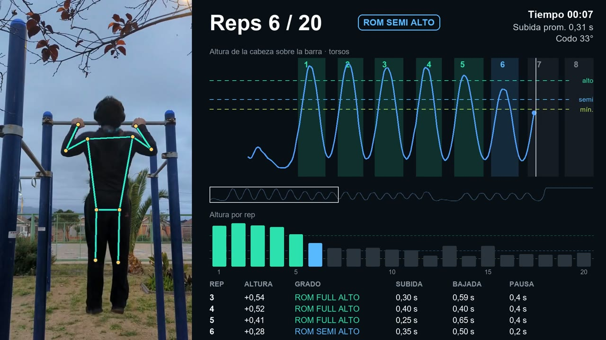

# vision-demos

Real-world computer vision demos. Each folder is a self-contained demo with its own README and setup.

| Project | What it does | Key model |
|---|---|---|
| [Pull-ups](pull_ups/) | Counts pull-up reps, times each one, and grades how high it goes against the athlete's own calibration | MediaPipe Pose (local) |

## Pull-ups

Sample output, 20 reps with grip changes: [watch on YouTube](https://www.youtube.com/watch?v=HACXz5mu7Yk). The same file is in [pull_ups/samples/](pull_ups/samples/).

Setup, usage and limits are in [pull_ups/README.md](pull_ups/README.md) and [pull_ups/how_it_works.md](pull_ups/how_it_works.md).

## License

Apache-2.0. See [LICENSE](LICENSE).
