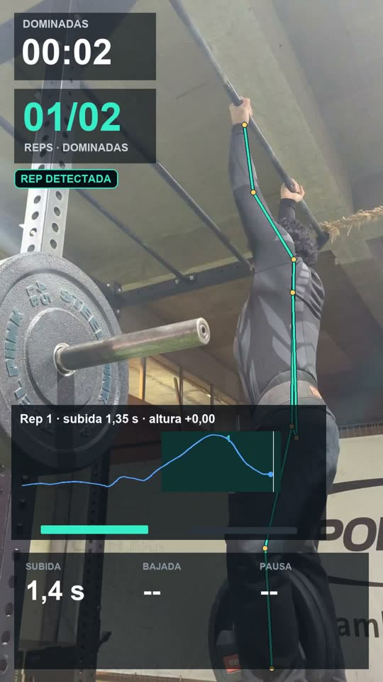

# Pull-ups

Pull-up rep counting, timing and height grading from pose estimation. Runs locally with MediaPipe Pose.

Run the commands below from this folder (`pull_ups`).

| Project | What it does | Key model |
|---|---|---|
| Pull-ups | Counts reps, times each one, grades how high it goes against the athlete's own calibration, and renders a reel or horizontal analysis video | MediaPipe Pose (local) |

Sample video (20 reps, horizontal layout): [watch on YouTube](https://www.youtube.com/watch?v=HACXz5mu7Yk)

Side-view example (2 reps, the only side-view clip checked so far): [watch on YouTube](https://youtu.be/L_C7bp-_LhI)

Details and limits are in [how_it_works.md](how_it_works.md).

Sample output, 20 reps with grip changes (horizontal layout): [samples/pullups-20-horizontal.mp4](samples/pullups-20-horizontal.mp4)

## Run it

1. Create the environment (Python 3.12):

       python -m venv .venv
       .venv\Scripts\activate
       pip install -r requirements.txt

2. Install FFmpeg and make sure `ffmpeg` and `ffprobe` are on your PATH.

3. Put a clip in `data/input/`. Film from the front, the back or the side, with the whole body and the bar in frame. So far, one side-view clip has been checked (2 reps); side views need more tests. The first run extracts the pose and caches it in `data/cache/`.

4. Optional: build a calibration from reps you know are valid. Describe them in a JSON file and run:

       python calibrate.py reference.json

   The example file is in `docs/calibration-example.json`. Use the highest reps for `alto`, the lowest valid reps for `minimo`, and set `static_camera` only if the camera did not move during the set.

5. Analyze a clip:

       python main.py data/input/set.mp4
       python main.py data/input/set.mp4 --calibration data/calibrations/mis-dominadas-demo.json --layout horizontal
       python main.py data/input/set.mp4 --static-camera

   `--layout` is `reel` (1080×1920, default) or `horizontal` (1920×1080).

## Output

Each run creates a folder under `data/output/`:

    data/output/20260610-203000-set/
    ├── analysis-reel.mp4   # analysis video with skeleton, counter and grades
    ├── reps.json           # one entry per rep: start, peak, end, height, grade
    ├── report.txt          # summary of the set
    └── run.json            # clip hash, parameters and pose backend used

`data/` is ignored by git, so clips, cached poses and calibrations stay on your machine.

## Tests

    python -m unittest tests.test_pullup_demo

## License

Apache-2.0. See [LICENSE](LICENSE).
